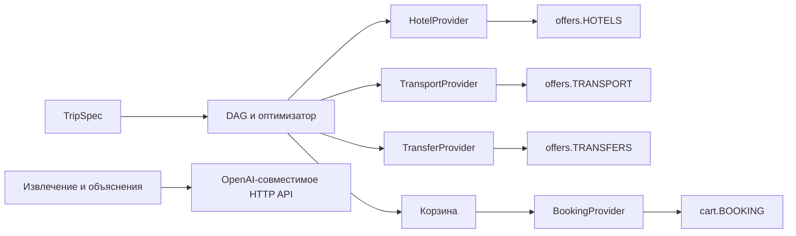

# О!дин запрос — AI-агент путешествий (трек Островка, команда nedovost-org)

Агент превращает одно сообщение путешественника («тёплое море в ноябре, недорого, с ребёнком») в готовую поездку. Он ведёт по этапам: уточнение, вдохновение, выбор направления, сравнение отелей и транспорта, объяснение выбора, план со стыковками, корзина, имитированная покупка. Если условия меняются («на два дня позже», «с нами едет собака»), агент пересобирает только зависимые части плана.

- Видео-скринкаст: ещё не записано, ссылку добавит задача #22.
- Развёрнутый сервис: нет. Задача #29 открыта. Жюри запускает решение локально.

**Важно для жюри.**
- Цены, тарифы, рейсы и поезда — **синтетика** (допущение команды). Данных и API Островка у нас нет. В UI у каждой синтетической цены стоит пометка «синтетика». Исключения по умолчанию: при сети отели идут с 101hotels (цена «от» на сегодня), с `TRAVELPAYOUTS_TOKEN` рейсы — из Авиасейлс; у такой цены стоит чип с названием источника. Переключатель «Синтетика» в UI делает синтетическими все цены.
- Ключ LLM не нужен. Без ключа агент работает по правилам и шаблонам. В UI виден значок «без ИИ — упрощённый режим». Путь до брони тот же.
- Оплата имитируется. Реальных броней нет.

## Для кого

Путешественник, который сейчас планирует поездку в 4–10 вкладках и сам сверяет даты, стыковки и трансферы. Островок получает путь до покупки внутри одного сервиса. Отель получает гостей, которым он подходит: агент показывает условия отмены и сравнивает тарифы.

## Быстрый старт

```bash
git clone https://github.com/ostrovok-hackathon-2026/nedovost-org.git
cd nedovost-org
cp .env.example .env   # с ключами жюри: расшифруйте secrets.env.age в .env (раздел «Переменные окружения»)
docker compose up --build
# открыть http://localhost:8080
```

Замер 2026-10-27, коммит `22e7bd4`, чистый клон, `.env` без ключа, образы node, python и uv уже в локальном кеше. `time docker compose build --no-cache` — `real 0m19.445s` (`npm ci`, `uv sync` и сборка фронтенда с нуля). `time docker compose up --wait` — `real 0m5.747s` до статуса `Healthy`. `curl -fsS localhost:8080/health` — `{"status":"ok"}`, HTTP 200. Итого около 25 с. Скачивание базовых образов добавит время по скорости сети. Контейнер работает от `uid=10001(app)`.

Нужны: Docker с командой `docker compose` и свободный порт 8080. Интернет нужен для сборки образа. Приложение по умолчанию сеть не использует: снапшоты данных лежат в репозитории. Сеть нужна только для необязательных LLM и реальных рейсов (`TRAVELPAYOUTS_TOKEN`).

Рекомендованные ресурсы: не измерялись.

Проверка, что сервис поднялся:

```bash
curl http://localhost:8080/health
# {"status":"ok","data_mode":"синтетика","hotels":"101hotels (живые) / синтетика при сбое","transport":"синтетика","transfers":"синтетика","catalog":"снапшот","llm_mode":"правила","llm_paused":false}
```

`data_mode` — режим данных (синтетика, снапшот или реальный): наименьший из режимов источников отелей, транспорта и трансферов. `llm_mode` — «правила» без ключа или имя модели. `hotels` называет живой слой 101hotels; при сбое сети отели синтетические, поэтому `data_mode` остаётся «синтетика». Ключи и адрес модели в ответ не попадают.

### Запуск без Docker (для разработки)

Нужны: `make`, `uv`, Python 3.12 (версия в `backend/.python-version`), `node` 22+.

```bash
make setup    # зависимости backend (uv) и web (npm ci)
make demo     # собирает web и поднимает http://localhost:8080
```

Другой порт: `make demo PORT=8091`.

## Что жюри запускает и как

| Что | Команда | Что увидите |
|---|---|---|
| Приложение | `docker compose up --build`, затем http://localhost:8080 | чат слева, доска поездки справа |
| Сквозной сценарий в браузере | `make e2e` | `2 passed`: запрос → сравнение → план → корзина → ваучер → перезагрузка; экран телефона |
| Видимые eval-кейсы | `make eval` | таблица из 11 сценариев и строка `RESULT: …` |
| Все тесты | `make check` | линтеры, тесты backend и web, тест на каждую ловушку |

`make eval-final` в README не описан. Он открывает закрытый набор и работает только в режиме «финал» (`CLAUDE.md`).

### Пример сессии (без ключа LLM)

В чат пишем по одному сообщению. Ответы агента получены на коммите `98612cd` в режиме без ИИ.

1. `тёплое море в ноябре, недорого, с ребёнком` → этап «вдохновение»: 4 направления из каталога (Манавгат, Монастир, Александрия, Акаба) с ценой, временем в пути, дневной температурой воздуха и воды. У каждого — причина и минусы, например «вода 21.8 °C — на границе комфорта». Допущения названы: возраст ребёнка 7 лет, взрослых 2, 7 ночей. Рядом агент спрашивает, сколько взрослых едет с ребёнком.
2. `Анталья` → этап «сравнение»: 5 отелей и варианты транспорта, цены с пометкой «синтетика».
3. `да, собираем` → этап «план»: таймлайн вылет → прилёт → трансфер → заселение → выезд → возврат. Чекер сообщает ожидание 6 ч 35 мин между выездом из отеля и трансфером в аэропорт.
4. Дальше — кнопки на доске: «В корзину», «Подтвердить бронь на … ₽» → ваучер с номером брони.

Другой короткий запрос: `Выходные в Казани, из Москвы, 2 взрослых, 11–13 декабря, до 50 тысяч на всё.` Он доходит до ваучера на 24 100 ₽ (синтетика при `LIVE_HOTELS=0`; коммит `bf0163f`, режим без ИИ).

## Маршруты

| Маршрут | Что делает |
|---|---|
| `/` | UI: чат и доска поездки |
| `/health`, `/api/health` | `200`, `{"status":"ok", data_mode, llm_mode, ...}`: режим данных и режим LLM |
| `GET /api/mode` | `200`, `{"llm": bool, "real_data": bool}`: есть ли ключ модели и живой источник данных. Нет ключа модели — в UI пометка «Без ИИ» и подпись о ключе |
| `POST /api/chat` | сообщение `{session_id?, message, llm?, real_data?}` → ответ: этап, текст, вопросы, план, корзина, ваучер, флаг `llm`. `llm` и `real_data` по умолчанию `true`; `real_data: false` — все цены синтетика |
| `GET /api/session/{id}` | восстановить сессию |
| `POST /api/cart` | `{session_id, action: add|remove, offer_id}` |
| `POST /api/checkout` | `{session_id, confirm_total_rub}` → ваучер (оплата имитируется) |
| `POST /api/v1/plan` | только для партнёров: текст запроса → план с заполненной корзиной за один вызов |
| `GET /embed.js` | виджет чата для чужой страницы |

Типы запросов и ответов — `backend/src/api/contracts.py`. Тестовых пользователей нет. Входа нет.

## Как встроить

Базовый адрес после запуска — `http://localhost:8080/api/v1`. Все маршруты таблицы выше доступны и с префиксом `/api/v1`: например, `POST /api/v1/chat` и `GET /api/v1/session/{session_id}`. Старый `/api` остаётся для веб-интерфейса: оба адреса читают одни сессии. JSON-модели одни и те же: `backend/src/api/contracts.py`.

OpenAPI: [JSON-схема](http://localhost:8080/openapi.json), [Swagger UI](http://localhost:8080/docs), [ReDoc](http://localhost:8080/redoc). Маршруты партнёра — в группе «Партнёрский API /api/v1», с описаниями и примерами тел. Некорректное тело даёт 422, неизвестная сессия — 404, отказ покупки или изменение итога — 409, нет ключа — 401.

Что есть для партнёра:

| Что | Как |
|---|---|
| План одним вызовом | `POST /api/v1/plan` с `{"message": "…"}` → `ChatReply`: `stage=checkout`, корзина `cart`, объяснения `plan.explanations`, таймлайн `plan.timeline`. Это тот же агент, что и `/api/v1/chat`: он сам берёт первое направление и лучший вариант. Бронь не оформляется |
| Уточнение | агенту нужен ответ путешественника — `questions` не пуст, этап не `checkout`. Пошлите ответ в `POST /api/v1/plan` с тем же `session_id`. Так же работает пересборка: `{"session_id": "…", "message": "а подешевле?"}` |
| Ключ партнёра | `PARTNER_API_KEYS=key1,key2` в `.env`. Тогда `/api/v1` (кроме `health` и `mode`) требует заголовок `X-API-Key`; без ключа или с чужим — 401. Пусто — доступ открыт. Это метка партнёра для `/api/v1`, а не защита: веб-клиентский `/api/*` (чат, корзина, оформление) открыт и делает те же операции. Веб-интерфейс ключ не требует |
| Бронь без дублей | заголовок `Idempotency-Key` на `POST /api/v1/checkout`: повтор с тем же ключом вернёт тот же ваучер и не создаст вторую бронь. Тот же ключ с другим телом — 422 |
| Вебхук брони | `BOOKING_WEBHOOK_URL`: после новой брони туда уходит `POST` с JSON ваучера и заголовком `X-Booking-Id`. Ожидание — `BOOKING_WEBHOOK_TIMEOUT_S` (3 с). Сбой вебхука бронь не отменяет, он пишется в лог |
| Вызов из браузера | `ALLOWED_ORIGINS=https://shop.example` — CORS для домена партнёра |
| Виджет | `<script src="http://localhost:8080/embed.js" data-partner="my-shop" async></script>` — кнопка и панель с чатом агента (iframe). Пример — `examples/embed.html` |

Оплата везде имитируется: у ваучера `simulated=true`, цены — синтетика.

**curl.** План, затем бронь (без ключа в `.env` заголовок `X-API-Key` можно не слать):

```bash
curl -fsS http://localhost:8080/api/v1/plan \
  -H 'Content-Type: application/json' -H 'X-API-Key: key1' \
  --data-binary @- <<'JSON' > plan.json
{"message":"Выходные в Казани, из Москвы, 2 взрослых, 11–13 декабря, до 50 тысяч на всё."}
JSON
python3 -c 'import json; r = json.load(open("plan.json")); print(r["stage"], r["cart"]["total_rub"])'
# checkout 24100

# Idempotency-Key — свой на каждую покупку; повтор с ним вернёт тот же ваучер
curl -fsS http://localhost:8080/api/v1/checkout \
  -H 'Content-Type: application/json' -H 'X-API-Key: key1' -H 'Idempotency-Key: order-1001' \
  -d "$(python3 -c 'import json; r = json.load(open("plan.json")); print(json.dumps({"session_id": r["session_id"], "confirm_total_rub": r["cart"]["total_rub"]}))')"
# {"booking_id":"B-…","items":[…],"total_rub":24100,"status":"confirmed","simulated":true,…}
```

**Python** (только стандартная библиотека):

```python
import json
import urllib.request

BASE, KEY = "http://localhost:8080/api/v1", "key1"


def post(path, body, **headers):
    req = urllib.request.Request(
        BASE + path,
        data=json.dumps(body).encode(),
        headers={"Content-Type": "application/json", "X-API-Key": KEY, **headers},
    )
    with urllib.request.urlopen(req, timeout=60) as resp:
        return json.load(resp)


plan = post("/plan", {"message": "Сочи на неделю в ноябре, 2 взрослых"})
if plan["questions"]:  # агенту нужен ответ путешественника
    print(plan["questions"][0]["text"])
else:
    for item in plan["cart"]["items"]:
        print(item["title"], item["price_rub"])
    voucher = post(
        "/checkout",
        {"session_id": plan["session_id"], "confirm_total_rub": plan["cart"]["total_rub"]},
        **{"Idempotency-Key": "order-" + plan["session_id"]},
    )
    print(voucher["booking_id"], voucher["status"], voucher["simulated"])
```

**JavaScript** (браузер или Node 18+; из браузера на другом домене — `ALLOWED_ORIGINS`):

```js
const BASE = "http://localhost:8080/api/v1";
const headers = { "Content-Type": "application/json", "X-API-Key": "key1" };

const plan = await fetch(`${BASE}/plan`, {
  method: "POST",
  headers,
  body: JSON.stringify({ message: "Тёплое море в ноябре, недорого, 2 взрослых и ребёнок 5 лет" }),
}).then((r) => r.json());

if (plan.questions.length) {
  console.log(plan.questions[0].text);
} else {
  console.log(plan.plan.spec.destinations, plan.cart.total_rub, plan.plan.explanations[0].why);
  const voucher = await fetch(`${BASE}/checkout`, {
    method: "POST",
    headers: { ...headers, "Idempotency-Key": `order-${plan.session_id}` },
    body: JSON.stringify({ session_id: plan.session_id, confirm_total_rub: plan.cart.total_rub }),
  }).then((r) => r.json());
  console.log(voucher.booking_id, voucher.status, voucher.simulated);
}
```

Пошаговый диалог — `POST /api/v1/chat` с `{session_id?, message}`; ответ сессии можно восстановить через `GET /api/v1/session/{session_id}`.

Схема портов соответствует [ADR-0002](docs/adr/ADR-0002-porty-i-adaptery.md):



Своего провайдера отелей подключите классом с методом `HotelProvider.hotels(spec, place, now)`. При старте присвойте его экземпляр `api.offers.HOTELS`. Метод возвращает пары `(HotelOffer, list[ExtraOffer])`. Цены — за всех гостей и все ночи. Пустой ответ означает отсутствие предложений. Методы других портов и проверки перечислены в разделе «Архитектура и стек» ниже. Отдельного переключателя провайдера в `.env` нет.

Для своей LLM задайте в `.env` `LLM_BASE_URL`, `LLM_MODEL` и `LLM_API_KEY`. Клиент вызывает `POST <LLM_BASE_URL>/chat/completions`. Адрес должен быть доступен из процесса приложения; внутри Docker `localhost` указывает на контейнер. GigaChat поддерживает также `GIGACHAT_AUTH_KEY`. После смены настроек перезапустите приложение. С ключом модель работает по умолчанию: переключателя в UI нет, в `POST /api/chat` и `/api/v1/plan` флаг `llm` по умолчанию `true`. Без ключа или с `"llm": false` работают правила, в ответе `llm=false`. Настройки и поведение при отказе API — в разделе «Переменные окружения».

**Реальные данные.** Каталог мест и снапшот OSM уже используются по умолчанию. С `TRAVELPAYOUTS_TOKEN` в `.env` рейсы до выбранного места могут идти из Travelpayouts (адаптер `REAL_TRANSPORT`, #261). Реальные данные включены по умолчанию (#566). Переключатель «Синтетика» в UI или `"real_data": false` даёт синтетику во всех источниках. Цены поездов, трансферы и покупка остаются синтетическими. Цены отелей при сети — «от N ₽» с 101hotels на сегодня (#528), с чипом «101hotels» в UI; без сети — синтетика. Для других живых данных нужно реализовать и присвоить адаптеры `HOTELS`, `TRANSPORT`, `TRANSFERS` и `BOOKING`. Ключ LLM их не включает. Вдохновение оценивает направления синтетически, даже при подключённом живом провайдере. Точный состав данных — в разделе «Данные».

## Архитектура и стек

Решение D-001 (`docs/decisions.md`, `docs/adr/ADR-0001-avtomat-etapov-dag-optimizator.md`): автомат этапов + `TripSpec` + DAG пересборки + детерминированный оптимизатор.

- `TripSpec` — типизированная спецификация поездки. Это единственный источник правды.
- LLM (OpenAI-совместимое API) делает две вещи: извлекает поля `TripSpec` из текста и пишет «почему» по фактам плана (D-008). Цены, время и id предложений он не пишет (TRAP-4). Проверка отбрасывает числа, которых нет в фактах.
- Подбор и сравнение делает оптимизатор: отели × транспорт × трансферы. Стыковки проверяет чекер таймлайна с часовыми поясами. Это код, не LLM.
- DAG пересборки: правка `TripSpec` пересчитывает только зависимые узлы.
- Без ключа LLM работают экстрактор на правилах и шаблонные объяснения (TRAP-1).
- Стек: Python 3.12, FastAPI, pydantic, SQLite (сессии); React, Vite, TypeScript. Один контейнер, multi-stage `Dockerfile`, пользователь не root, `HEALTHCHECK`.

**Как подключить своего провайдера.** Источники данных — порты (`docs/adr/ADR-0002-porty-i-adaptery.md`). Интерфейсы `HotelProvider`, `TransportProvider` и `TransferProvider` — раздел «Порты» в `backend/src/api/contracts.py`. Напишите класс с методом порта: `hotels`, `legs` или `transfers`. Присвойте его объект переменной модуля `backend/src/api/offers.py`: `HOTELS`, `TRANSPORT` или `TRANSFERS`. Присваивание делают при старте (`main.py`) или в тесте. Сейчас там адаптеры `OsmOrSynthetic`, `SyntheticTransport`, `SyntheticTransfers`. Ядро не разбирает ваши id и названия, если заполнены поля: у услуги — `ExtraOffer.tag` (`early`, `late`, `prev`) и `at` (местное время), у трансфера — `hotel_offer_id` и `leg_offer_id`. Ядро ставит трансферу свой `offer_id` по паре, а ваш id хранит в `ref`. Без полей ядро разбирает id и название, как раньше. Проверка своего адаптера: добавьте набор в `ADAPTER_SETS` в `backend/tests/test_ports.py`, например `"mine": (MyHotels(), offers.TRANSPORT, offers.TRANSFERS)`, затем запустите `make check`. Тесты проверяют инварианты ядра и путь до ваучера на каждом наборе. Образец — набор `foreign`: id без суффиксов, названия без времени и км. Тесты не видят адаптер, который присвоен в `main.py`: проверяется только набор из `ADAPTER_SETS`. Вдохновение, тупик «с питомцем» и `make eval` оценивают десятки мест через синтетические адаптеры `ESTIMATE_HOTELS`, `ESTIMATE_TRANSPORT`, `ESTIMATE_TRANSFERS`. Живой провайдер вызывается только для выбранного места. Пустой ответ провайдера — «нет предложений», синтетикой он не заменяется. Исключение — провайдер-кэш вроде Travelpayouts: пустой ответ значит «этот маршрут никто не искал», а не «рейсов нет». Тогда адаптер даёт синтетический рейс с пометкой «синтетика» и пишет это в лог (D-032).

**Как подключить систему бронирования.** Покупка — порт `BookingProvider` в том же разделе «Порты». Методы: `quote` (цены корзины сейчас), `book` (бронь, ключ идемпотентности — `session_id`) и `cancel`. Присвойте объект своего класса переменной `BOOKING` в `backend/src/api/cart.py`. Сейчас там `SimulatedBooking`: цены не меняются, ваучер помечен `simulated=True` и в UI подписан «имитированы». Статусы брони: `created`, `confirmed`, `cancelled`. Отказ — исключение `BookingRefused(причина)`: агент отвечает 409 с причиной и сохраняет корзину. Другая цена в `quote` — 409 «Итог корзины…», и следующее подтверждение оформляет бронь по новой цене. Повтор оплаты возвращает ту же бронь: это правило ядра. Отмены в интерфейсе пока нет: есть метод порта и правило «после отмены — новая бронь». Проверка — `backend/tests/test_booking_port.py`.

Все решения — `docs/decisions.md` (D-001…D-010).

## Данные

Данных Островка у нас нет. Что есть:

| Что | Источник | Объём | Где | Статус |
|---|---|---|---|---|
| Каталог мест: координаты, часовой пояс, аэропорт, климат по месяцам | GeoNames (CC BY 4.0), OurAirports, OpenFlights (ODbL), Open-Meteo (CC BY 4.0): воздух и осадки 2016–2025, море 2023–2025 | 445 мест (158 в России) в 84 странах, 52 города вылета, 3244 аэропорта | `backend/src/api/catalog.json`, сборка — `scripts/build_catalog.py` | реальные данные; расстояние до вокзала — оценка команды; уровень цен — у 50 мест России по ценам 101hotels.com (снято 2026-10-27, `prices_101hotels.json`), у прочих — оценка команды |
| Отели | OpenStreetMap (ODbL 1.0), снапшот Overpass от 2026-10-26 | 5 отелей, только Казань | `backend/src/api/osm_hotels.json` | реальные названия и звёзды; всё остальное — синтетика |
| Отели России при сети | 101hotels (живой слой, `LIVE_HOTELS`, #528): имя и цена «от» за ночь | города России, где есть хотя бы 3 именованных карточки | `backend/src/api/live_hotels.py` | реальные имя и цена «от»; итог за ночи, питание и отмена — оценка |
| Отели в других городах | генерация по хэшу города | 2–4 тарифа на отель | `backend/src/api/offers.py` | синтетика |
| Цена, питание, отмена, рейтинг | детерминированная генерация | все предложения | `backend/src/api/offers.py` | синтетика |
| Рейсы, поезда, трансферы, допы | детерминированная генерация по расстоянию | все предложения | `backend/src/api/offers.py` | синтетика; тариф поезда подобран по медиане цен tutu.ru на 84 маршрутах из Москвы (снято 2026-10-27, `prices_tutu.json`): синтетика / tutu — 1,01, до калибровки 1,61 |
| Направления для вдохновения | выбор из каталога мест по тегам, морю и климату месяца | 2–4 карточки из 445 мест | `backend/src/api/inspire.py` | факты — из каталога; список стран Европы и пороги — допущения команды |

Одни и те же параметры дают одни и те же предложения. Для городов каталога сеть не нужна: оба снапшота — файлы в образе (TRAP-6). Город вне каталога агент ищет в Open-Meteo; без сети он честно отвечает «нет в каталоге». Папка `data/` в git пуста: там только `data/README.md`. Сессии чата пишутся в SQLite (`SESSIONS_DB`). В `docker-compose.yml` тома нет, поэтому сессии живут до пересоздания контейнера.

Сидировать ничего не нужно.

## Переменные окружения

Файл `.env.example`. Ключи LLM можно оставить пустыми: тогда агент работает по правилам.

Ключи для жюри лежат в `secrets.env.age`: это `.env`, зашифрованный `age` публичным ключом организаторов. Провайдер LLM — GigaChat, модель — `GigaChat-3-Ultra`. Расшифровка: `age -d -i <закрытый ключ> -o .env secrets.env.age`. В файле ключи `GIGACHAT_AUTH_KEY` и `TRAVELPAYOUTS_TOKEN`, они выпущены только для жюри. Остальные переменные совпадают с `.env.example`. Затем запустите `docker compose up --build`. С ключом GigaChat работает сразу, переключателя нет. Переключатель «Синтетика» делает все цены синтетическими.

| Переменная | По умолчанию | Назначение |
|---|---|---|
| `LLM_API_KEY` | пусто | статичный ключ OpenAI-совместимого API |
| `GIGACHAT_AUTH_KEY` | пусто | ключ авторизации GigaChat; агент сам меняет его на токен доступа |
| `GIGACHAT_SCOPE` | `GIGACHAT_API_PERS` | область доступа GigaChat |
| `GIGACHAT_OAUTH_URL` | пусто → адрес выдачи токена Сбера | адрес выдачи токена GigaChat |
| `LLM_BASE_URL` | `https://api.giga.chat/v1` | адрес API |
| `LLM_MODEL` | `GigaChat-3-Ultra` | имя модели (D-022) |
| `LLM_TIMEOUT_S` | `8` | ожидание ответа модели, секунды |
| `SESSIONS_DB` | пусто → `data/sessions.db`; в Docker `/app/data/sessions.db` | файл сессий |
| `APP_PORT` | `8080` (задан в `Dockerfile`) | порт внутри контейнера |
| `PARTNER_API_KEYS` | пусто → `/api/v1` открыт | ключи партнёров через запятую; заголовок `X-API-Key` |
| `BOOKING_WEBHOOK_URL` | пусто → вебхука нет | адрес для `POST` ваучера после новой брони |
| `BOOKING_WEBHOOK_TIMEOUT_S` | `3` | ожидание ответа вебхука, секунды |
| `ALLOWED_ORIGINS` | пусто → только тот же адрес | домены для CORS через запятую, или `*` |
| `TRAVELPAYOUTS_TOKEN` | пусто → все рейсы синтетика | токен Travelpayouts: рейсы до выбранного места из `prices_for_dates` (`backend/src/api/travelpayouts.py`), кэш в `data/travelpayouts/`. Это самый дешёвый билет из кэша поисков Aviasales, не цена брони. Цена взрослого — из API; детский тариф — оценка (доля цены взрослого), это написано в названии рейса. Нет кода аэропорта, ошибка сети или пустой ответ — рейс синтетический, с пометкой |

Модель доступна, только если заданы `LLM_BASE_URL`, `LLM_MODEL` и ключ: `LLM_API_KEY` или `GIGACHAT_AUTH_KEY`. С ключом её запрос включён по умолчанию (`"llm": true`). Для GigaChat достаточно вписать ключ авторизации: адрес и модель уже есть в `.env.example`. Без ключа — режим правил. Таймаут, 401/403, 429, 5xx и неверный JSON дают ответ по правилам, а не ошибку.

Остальные переменные `.env.example` (`TAKEOVER_MIN`, `MAX_FILE_MB`, `TEMPLATE_REPO`) нужны только процессу команды. Приложению они не нужны.

## Результат

Метрика: доля сессий, доведённых до брони (ваучера). Команда: `make eval` (видимые кейсы `eval/cases.json`, правила без LLM).

| | Система | Baseline |
|---|---|---|
| Доля сессий, доведённых до брони | 1.0 | 0.0 |
| Сценарии `make eval` | 11 из 11 (критических 3 из 3), `make eval` | — |
| Ошибки стыковок в итоговых планах | 0 | — |
| Время до первой рекомендации | медиана 22.0 мс, максимум 100.9 мс (коммит `b2b1b15`, ноутбук команды; число меняется от запуска) | — |

Как читать:
- Baseline — «тривиальный ответ»: один промпт к LLM «спланируй поездку» и текст маршрута в чате. Корзины, проверки стыковок и пересборки нет, цены выдуманы (`eval/baseline.json`). Мы приняли его за 0 по метрике. Сам baseline мы не запускали.
- В выборке 22 сессии. Из них 14 идут до брони, и все 14 дошли до ваучера. Сессия S11 тоже доходит до ваучера, но в «идут до брони» не входит: она идёт без попытки брони (`attempt=False`).
- S10 проверяет тему вдохновения на двух запросах жюри («в горы летом с собакой», «горнолыжка в феврале»): 2–4 карточки, наверху места с тегом `mountains` или `ski` из `catalog.json`, нарушающие запрос карточки не выше подходящих. Тест `test_s10_fails_on_the_inspiration_before_20_seven_cities` показывает, что на 7 городах до #20 проверка красная.
- S11 проверяет поездку из двух городов («Из Москвы в Питер на 2 ночи, потом в Казань на 2 ночи»): план пока только по Питеру, но Казань названа в ответе, есть кнопка «План: Казань», строка допущений «маршрут:» с Казанью есть в ответе, в корзине и в ваучере. Полный план из двух городов остаётся открытым (#128).
- Кейсы написали мы сами. Они не независимы. Закрытый набор (`make eval-final`) не запускался.
- Время — локальное, в процессе, без сети и LLM (`perf_counter`). Это не время ответа через браузер или модель.
- S5: видимый пул из 10 запросов доходит до брони 10 из 10 (порог ≥ 8). Отдельный пул незнакомых запросов (`eval/cases_unseen.json`, 22 запроса, агента на нём подгоняли дважды: правка TRAP-3 «Гори» ≠ «Гоа» и правка #121 (падежи и многословные названия: «в Старую Ладогу», «в Бледе»; её тесты берут города этого же пула); последние 10 написал свежий субагент без доступа к файлам): строка `make eval` — «незнакомые: до брони 22 из 22, без нарушений 20 из 22 (режим правил, без LLM, без сети; … вне catalog.json и osm_hotels.json: бронь в названном городе 5 из 5)». Было 17 из 22 до правки #121. Оба числа измерены на одном пуле, на котором правку и писали, поэтому 22 из 22 — не оценка на незнакомых запросах. «Вне данных» — вне `catalog.json` и `osm_hotels.json` (решение человека, D-017). Таких городов в пуле 5 (Гори, Старая Ладога, Чески-Крумлов, Блед, Сиена); 5 других городов субагента каталог знал. Город вне каталога агент ищет геокодером Open-Meteo. В `make eval` геокодер читает записанные ответы (`eval/geocoder_answers.json`), а не сеть. Файл записан `checks.record_geocoder` (16 ответов, 2026-10-27), S5(б) проверяется: по `make eval` S5 зелёный, 5 городов вне данных из 5 забронированы в названном городе. Часть ограничений по данным системы не проверить: «недорого» без суммы (#111). Такие запросы не считаются «без нарушений». Лыжи проверяет `make eval` по тегу `ski` города брони.

Проверки (`make check`): 2130 тестов backend, 47 тестов web, линтеры, тест на каждую из 7 ловушек данных.

## Ловушки данных и что с ними

| Ловушка | Что сделано |
|---|---|
| TRAP-1 нет ключа LLM | режим по правилам, значок «без ИИ», путь до брони тот же (eval S3) |
| TRAP-2 незнакомые запросы | каталог 445 мест в 84 странах; город вне каталога — геокодер Open-Meteo и климат за год, без сети — честный ответ «нет в каталоге» |
| TRAP-3 написания топонимов | нормализация названий, падежи, варианты ru/en из GeoNames, близкое написание («Антлия» → Анталия, но «Малага» ≠ Мале) |
| TRAP-4 выдуманные цены | цены, время и стыковки приходят только из кода; объяснение LLM проверяется на посторонние числа и id |
| TRAP-5 стыковки и часовые пояса | детерминированный чекер таймлайна; его пороги — оценки команды без источника (D-007) |
| TRAP-6 нестабильная сеть | каталог и климат — снапшоты в репозитории, без сети. Отели России при сети идут с 101hotels (`LIVE_HOTELS=1` по умолчанию), снапшот и синтетика — запасной вариант без сети. Сеть нужна для города вне каталога: геокодеру и OSRM demo (аэропорт по дороге). Без геокодера — честный ответ «нет в каталоге», отказ сети помнится 60 с; без OSRM аэропорт — по прямой |
| TRAP-7 моки как реальные | у каждой цены — «синтетика» или чип источника («101hotels», «Авиасейлс») |

## Ограничения и что не сделано

- **Синтетика.** Цен, наличия и расписаний реальных поставщиков нет. Тарифы, рейсы и поезда сгенерированы. Реальны только названия и звёзды 5 казанских отелей из OSM.
- **Уровень цен и расстояние до вокзала** — оценка команды. Исключение — уровень цен у 50 мест России с 5 и больше отелями 3★ на 101hotels.com: по медиане их цены «от N ₽» без дат, снято 2026-10-27 (`scripts/calibrate_prices.py`). Это снимок конца октября: у мест у моря летом — цена межсезонья, умноженная на общий сезонный коэффициент `SEASON`. Цены предложений и там синтетика. Координаты, пояса, аэропорты и климат — из открытых источников (#8). Аэропорт — с регулярными рейсами по OurAirports. Если есть данные о дороге до каждого кандидата (`road: true`, у 24 мест из 445), берём ближайший по дороге. Но только если он короче пути до ближайшего по прямой на 15 % или на 20 км (хватает любого из двух). Иначе остаётся ближайший по прямой, его км — по дороге. Например, Дилижан: EVN 108 км, LWN 106 км, остаётся EVN. Без данных о дороге берём ближайший по прямой. Агент пишет в ответе «по дороге» или «по прямой». У Горно-Алтайска это Барнаул (BAX, 271 км по дороге): RGK в OurAirports без рейсов. Новокузнецк ближе по прямой (216 км), но дальше по дороге (372 км).
- **Закрытые аэропорты.** AAQ, EGO, BZK, VOZ, URS, LPK, ROV и SIP закрыты для рейсов (по данным на 27.10.2026, источники — `research/domain.md`). Перелёт идёт через ближайший открытый аэропорт той же страны, дальше — трансфер по расстоянию (первые 100 км — 35 км/ч, дальше — скорость машины); или поезд, или машина. Обратный рейс из GDZ — не позже 20:00, из KRR — не позже 23:00 МСК. Список правят в `CLOSED_AIRPORTS` (`backend/src/api/offers.py`).
- **Города вне каталога.** Каталог — 445 мест. Город вне каталога ищет геокодер Open-Meteo, климат — за 2025 год, не за 10 лет. Без сети ответ честный: на «Тихвин» и «Ухта» агент пишет «пока нет в каталоге, и геокодер его не нашёл (или нет сети). Где это место, не знаю». Если в сообщении нет страны, агент спрашивает только страну (регион он не узнаёт) и показывает города этой страны из каталога: они не обязательно рядом с местом. Если страну не узнал и со второго раза, даёт варианты кнопками под даты и пожелания, не по близости к месту. Аэропорт такого места — по дороге по публичному OSRM demo (router.project-osrm.org, одна выдача на место), без него — по прямой (`airport.road` = false). Онлайн-путь на демо зависит от лимитов Open-Meteo (10 000 вызовов в сутки на IP) и от OSRM demo. Бронь в городе вне каталога `make eval` пока не проверил (#107).
- **Вдохновение** выбирает 2–4 места из `catalog.json` только по полям каталога. Тема — из пожеланий: «море» — место с тегом `swim`: вода от 21,5 °C не меньше 3 месяцев в году, порог — оценка команды; «горы», «лыжи», «санаторий» — теги mountains, ski, spa. Без темы — города от 1 млн жителей (`CITY_POP`). «В Европу» — страны из списка `EUROPE`, без России, Белоруссии и Турции. «На юг» — на 5° широты южнее города вылета (`SOUTH_DEG`); в холодные месяцы (октябрь–апрель) ещё и тепло: днём от 15 °C, иначе карточка с нарушением. Список и пороги — допущения команды. Цену и время в пути считаем у 16 ближайших кандидатов, а не у всех 445 мест. Порядок карточек: подходящие; нарушают пожелание (холодная вода, долгая дорога, бюджет); не та тема; поездку не собрать (нет транспорта нужного вида или отеля с питомцами). Карточка с нарушением помечена «Нарушает требования». Поля «риски» в контракте нет: риски показаны в минусах.
- **Город вылета не назван** — первый ответ агента — вопрос «Откуда вы поедете?» с кнопками «Из Москвы», «Из Санкт-Петербурга», «Из Екатеринбурга», «Из Новосибирска», «Из Казани» и свободным вводом (#436). Остальное из первого сообщения агент сохраняет и после ответа не спрашивает снова. Ответ «Питер», «мск», «из Масквы» агент приводит к названию города каталога (TRAP-3), без модели тоже (TRAP-1). Другой вопрос (о детях, о составе, о месяце или о городе гостиницы) идёт в том же ответе, вторым; всего не больше 2 вопросов. Вопроса нет, если город назван или билеты уже куплены. Ответ без города — агент берёт Москву и пишет это в допущениях. «Начать заново» сохраняет город, который назвал пользователь. Если бюджет назван на всю поездку, вопрос называет суммы дороги, при одном из двух условий. Первое: дорога туда и обратно из Москвы дороже, чем из самого дешёвого из 10 крупных городов вылета, на 15 % бюджета или больше. Второе: дорога из Москвы одна стоит 50 % бюджета или больше. Города вылета ближе 500 км к месту не сравниваем: Ростов-на-Дону рядом с Сочи показал бы расстояние до места, а не город вылета (#380). Сравниваем только дорогу, не всю поездку. Вопрос называет обе суммы, разницу и её долю в бюджете. Суммы — из предложений (синтетика). Пороги 15 % и 50 % — оценка команды (#351). Порог 15 % близок к F15 из `eval/cases_fresh25.json`: там разница 16,5 % бюджета (Москва 56 400 ₽, Новосибирск 23 500 ₽).
- **После покупки.** Запрос «сдвинь даты на два дня» после ваучера получил ответ «Бронь уже оформлена». Ранний заезд и смена дат после покупки не сделаны (#18).
- **Память между сессиями** не сделана (#19).
- **Известные ошибки экстрактора правил** на редких названиях: города из двух слов в начале фразы (#82), «Добрич» (#87), глагол пересборки как город (#73). Открытые задачи.
- **LLM-режим** проверен тестами с подменой ответа модели (`backend/tests/test_llm.py`, `backend/tests/test_llm_gigachat.py`) и замером с GigaChat на сценариях eval (#117). `make eval` идёт без LLM. На eval LLM не лучше правил (D-022).
- **Docker.** Если порт 8080 занят, compose не стартует: освободите порт.
- **Ресурсы и нагрузка** не измерялись. Один процесс, сессии в SQLite.
- Платежа нет. Оплата имитируется, ваучер помечен `simulated`.
- Авторизации и пользователей нет.

## Внешние зависимости

- В работе приложения: нет (без сети, без БД-сервера, без LLM по умолчанию).
- Необязательно: GigaChat или любое OpenAI-совместимое API (`POST <LLM_BASE_URL>/chat/completions`) для режима с ИИ. Сертификат НУЦ Минцифры для GigaChat лежит в `backend/certs/`.
- При сборке: образы `node:22.23.4-bookworm-slim`, `python:3.12.15-slim-bookworm`, `ghcr.io/astral-sh/uv:0.12.19`; пакеты PyPI и npm (версии закреплены в `backend/uv.lock` и `web/package-lock.json`). Приватных зависимостей нет.
- Данные OSM: © участники OpenStreetMap, ODbL 1.0, https://www.openstreetmap.org/copyright.

## Для команды

Это не нужно, чтобы запустить продукт.

- Правила проекта и режимы — `CLAUDE.md`.
- Работа с git и PR — `GIT.md`.
- Роли агентов — `docs/agents.md`.
- Вехи — `docs/timeline.md`. Вопросы организаторам — `docs/questions-for-organizers.md`.
- Исследование — `research/`. Условия хакатона — `task/`.
- Цели `make`: `setup`, `lint`, `check`, `demo`, `eval`, `eval-final`, `e2e`.
