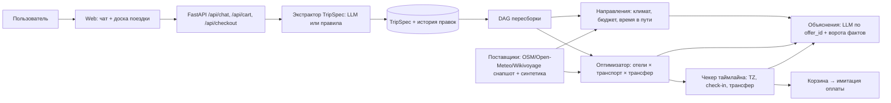

# ADR-0001: Автомат этапов + TripSpec + DAG пересборки + детерминированный оптимизатор (C6)

Status: proposed (autopilot) · Date: 2026-10-26 · Deciders: — (ждёт команду) · Supersedes: none

## Context
Агент Островка: одно сообщение → сценарий поездки → имитированная покупка; жюри даёт незнакомые запросы. Данных Островка нет; цены и транспорт без ключей недоступны (probe). У жюри может не быть ключа LLM. Веса: полнота пути 22, качество агента 22, достоверность 14, UX 14, запуск 10, скорость сборки 10, надёжность 8 (assumed). Бриф — `01-task-brief.md`.

## Decision
Типизированная спецификация поездки `TripSpec` — единый источник правды. LLM (OpenAI-совместимое API) делает только две вещи: извлекает/правит `TripSpec` из текста и пишет объяснения по фактам инструментов. Подбор, сравнение и проверку стыковок делает код: оптимизатор (направления × отели × транспорт × трансферы) и чекер таймлайна. Узлы плана связаны DAG-ом: правка спеки пересчитывает только зависимые узлы. Без ключа — экстрактор на правилах и шаблонные объяснения. Стек — пресет `web-fullstack` (FastAPI + React/Vite), UI «чат + доска поездки». Данные — реальные гео/климат/OSM/Wikivoyage (снапшот + онлайн) и детерминированная синтетика цен и транспорта с пометкой «синтетика».

## Options considered
| Option | Total, % (score.py) | Win share | Why not chosen |
|---|---|---|---|
| C6 Гибрид | 87,5 | 0,788 | выбран (proposed) |
| C2 Автомат + TripSpec | 81,0 | 0,168 | пересборка по этапам, без DAG; подбор частично в LLM |
| C3 LLM → оптимизатор | 75,5 | 0,045 | слабый диалог и вдохновение |
| C1 ReAct baseline | 55,5 | 0 | выдумывает цены, пересборка = поиск с нуля, без ключа не работает |
| C4 Иерархия агентов | отсечён на скрининге | | латентность, срок сборки |
| C5 Фреймворк | отсечён на скрининге | | доминируется C2 |

## Consequences
Хорошо: 0 выдуманных цен (ворота фактов); пересборка без поиска с нуля; работает без ключа; модули параллелятся на 5 человек через контракты.
Плохо: больше кода, чем у ReAct; диалог менее «живой» без LLM; синтетические цены — честно сказать на демо.
Смягчение: строим поверх C2 — M0 = автомат + TripSpec + доска; DAG и оптимизатор в M1; если не успеваем, DAG выбрасываем и остаётся рабочий C2. Финальная проверка всего таймлайна кодом страхует от пропущенной зависимости в DAG.

## Validation
Должны проходить критические видимые сценарии из `02-scenarios.md` и holdout на заморозке. Пересмотреть, если: ReAct-baseline с воротами фактов проходит ≥ столько же сценариев за меньшее время; или экстрактор ошибается в > 25 % запросов жюри-типа.
