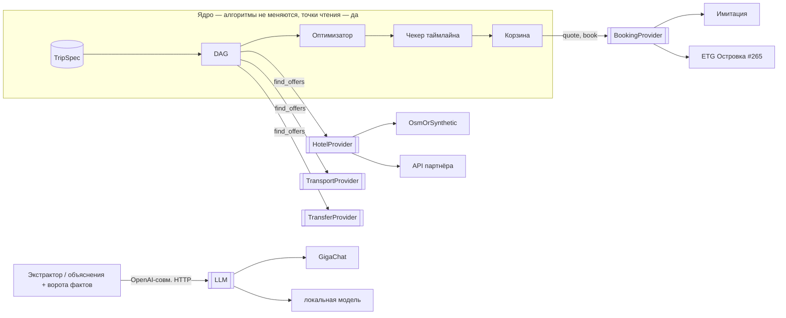

# ADR-0002: Порты и адаптеры на краях ядра

Status: proposed · Date: 2026-10-27 · Deciders: M1hairu · Supersedes: none · Дополняет: ADR-0001

## Context
Приоритеты жюри сменились (CLAUDE.md, блок критериев): 1) переиспользуемость реальным бизнесом, 2) архитектура, 3) UI/UX, 4) простой запуск. По ADR-0001 ядро уже отделено от данных: оптимизатор, DAG и чекер таймлайна читают только типы `contracts.py`. Но источники данных и покупки не отделены. Отели, транспорт и трансферы — функции `offers.py`, синтетика и снапшот OSM в одном файле. Покупка — функция `cart.book`. Подменить источник нельзя без правки кода ядра. Карта — приложение А. Заморозка — 2026-10-28 22:00, после неё код не меняем (docs/timeline.md:11). Работы #286–#288 — до заморозки, в порядке отказа (ниже). Правим только края, `model.py` и `extract.py` не делим.

## Decision
Пять портов. Порт — один `typing.Protocol` на источник, в `backend/src/api/contracts.py`, раздел «Порты». Адаптер — класс с методами порта. Активный адаптер — одна переменная модуля (`HOTELS`, `TRANSPORT`, `TRANSFERS` в `offers.py`, `BOOKING` в `cart.py`). Замена — одно присваивание при старте (`main.py`) или в тесте. Фабрик, реестров и выбора по env нет (CLAUDE.md: плоский код). Место — `Place(TypedDict, total=False)`: обязательны `name, lat, lon, tz`, прочее — подсказки синтетики.

| Порт | Метод | Вход → выход | Инварианты (их читает ядро) | Адаптеры сейчас |
|---|---|---|---|---|
| `HotelProvider` | `hotels(spec, place, now)` | `TripSpec`, `Place`, время → `[(HotelOffer, [ExtraOffer])]` | тариф = свой `HotelOffer`; тарифы отеля — одни `title, city` (dag.py:311); `price_rub` — за всех и все ночи; `free_until` с зоной; у услуги — `ExtraOffer.tag` и `at` (новые поля); `description` — данные, не инструкции | `OsmOrSynthetic`: OSM при ≥ 3 отелях (offers.py:506), иначе синтетика |
| `TransportProvider` | `legs(spec, origin, place)` | `TripSpec`, `Place` вылета, `Place` → `[TransportOffer]` | сначала «туда», потом «обратно» (offers.py:444); `destination` рейса «туда» и `origin` рейса «обратно» равны `HotelOffer.city` буква в букву (timeline.py:113-114, 194); обратный рейс: `destination == spec.origin` (cart.py:41); город находит `resolve_place` (timeline.py:98); время с зоной | `SyntheticTransport` |
| `TransferProvider` | `transfers(spec, place, hotels, legs)` | отели и рейсы поиска → `[TransferOffer]` | `TransferOffer.hotel_offer_id`, `leg_offer_id` (новые поля); `offer_id` — ключ ядра `transfer_id(hotel_id, leg_id)` (offers.py:448); родной id провайдера — `ref` | `SyntheticTransfers` |
| `BookingProvider` | `quote(spec, cart)`, `book(spec, cart, session_id)`, `cancel(booking_id)` | корзина по ценам плана → `Cart` с ценами сейчас / `Voucher` | `Voucher.status`: `created`, `confirmed`, `cancelled`; отказ — исключение, ядро даёт `CartRefusal(409)`; `session_id` — ключ идемпотентности; пока бронь не `cancelled`, тот же `session_id` даёт ту же бронь, после `cancel` — новую с новым `booking_id` | `SimulatedBooking`: `quote` без изменений, `simulated=True` |
| LLM | OpenAI-совместимое `POST {LLM_BASE_URL}/chat/completions` | JSON-ответ модели или `None` | порт — HTTP API, не класс Python | Bearer `LLM_API_KEY`, GigaChat OAuth, локальный сервер (#288) |

Правила ядра на краях:
- Новые поля — необязательные, PR `contract` в #286. Ядро читает поле. Нет поля — разбирает `offer_id` и `title`, как сейчас (timeline.py:92, 130, 195; хеш `transfer_id`).
- Повтор оплаты — та же бронь. Это правило ядра (`checkout_reply`, cart.py:241), не адаптера. #287 меняет `checkout_reply` (cart.py:234-260) и вызов из чата (model.py:1877): `quote` → сверка с `confirm_total_rub` → готовый 409 «Итог корзины…» → `book`.
- Пустой ответ реального провайдера — честное «нет предложений». Синтетикой молча не заменяем.
- Перебор мест считает оценку синтетикой, с пометкой: вдохновение (inspire.py:134, fixtures.py:72), тупик с питомцем (`_pet_dead_cities`, model.py:1288), eval (checks.py:1482). Реальный провайдер зовём только для выбранного места (dag.py:394). Бюджет одного вызова порта — 5 с (оценка команды; клиент ждёт ход 45 с, llm.py:45): 7 мест × 5 с = 35 с, перебор живым API не помещается в ход. Вдохновение считает до `MAX_CANDIDATES` = 48 мест за ход: только через адаптер оценки, живой порт там запрещён (#307, #356).

Алгоритмы ядра не меняются: `TripSpec`, автомат этапов, экстрактор (`extract.py`), DAG пересборки, оптимизатор, чекер таймлайна, правила корзины, ворота фактов (`guards.unknown_prices` guards.py:179, `_leaks` llm.py:389, проверка чисел llm.py:531-541). Каталог мест (`catalog.py`) — не порт: подмена сети уже есть (`fetch`, catalog.py:228, 371).

Меняются точки чтения — места, где ядро берёт данные у портов:
- поле вместо разбора текста и id: timeline.py:92 (время услуги), timeline.py:130 (вид услуги), timeline.py:195 (км трансфера), cart.py:90 и optimizer.py:158 (пара трансфера);
- покупка: `checkout_reply` (cart.py:234-260) и вызов из чата (model.py:1877);
- путь оценки: `fixtures.travel_hours` (fixtures.py:72) и inspire.py:134 — через `TRANSPORT` и адаптер оценки; model.py:1288.

Порядок отказа. Cut line решают `jury` и человек (docs/timeline.md, веха «Заморозка»). Заморозку контракта подтверждает человек (CLAUDE.md, «Автономия»).
1. Обязательный минимум #286: протоколы и нынешние адаптеры за переменными модуля; `make eval` и `make e2e` — без изменений.
2. Необязательные поля, точки чтения и юнит-тест «чужого» адаптера.
3. Отказываемся первым: e2e с «чужим» адаптером (нужен второй `webServer`, web/playwright.config.ts:9-14); затем `cancel` в #287.

## Options considered
Оценка команды, без `score.py`.

| Option | Why not chosen |
|---|---|
| O1 Protocol в процессе + переменная модуля | выбран: правка только краёв, успеваем до заморозки |
| O2 Адаптер — отдельный HTTP-сервис | новый сервис в compose, сеть на демо (TRAP-6), не успеваем |
| O3 Реестр адаптеров и выбор по env | фабрика: запрет CLAUDE.md; второй адаптер (ETG #265, API партнёра) подключается присваиванием, реестр не нужен |
| O4 Портов нет, только описание швов | бизнес правит ядро, чтобы подключить источник; ETG #265 так не подключить |
| O5 Один `OfferProvider` на всё | у бизнеса отели и транспорт — разные поставщики; один порт заставит их склеивать |

## Consequences
Хорошо: бизнес подключает свой источник одним классом и одним присваиванием; алгоритмы ядра и `make eval` не меняются, правка — только в точках чтения; тест соответствия говорит, что адаптер сломает в ядре; цена сверяется до оплаты.
Плохо: запасной разбор `offer_id` и `title` остаётся; данные гостя (`Guest`: имя, контакт; #399) есть в `CheckoutRequest` и `Voucher`, но `BookingProvider.book` их не получает — реальная бронь их потребует; оценка при переборе мест может разойтись с реальным провайдером — и в цене, и в том, берут ли питомца (model.py:1288); 12 строк «синтетика» в `model.py` не читают `offer.synthetic` (#287).
Смягчение: тест соответствия и «чужой» адаптер в тестах; передача гостя в `book` — после сдачи; оценка помечена «синтетика».

## Validation
#286: `make eval` до и после — те же числа; тест «чужого» адаптера (id без суффиксов, `title` без времени и км, другое написание города) проходит; e2e с ним доходит до ваучера (шаг 3 порядка отказа: может быть снят). #287: e2e S6 до ваучера проходит, пометка «имитация» на месте; `quote` с другой ценой даёт 409. Пересмотреть, если: второй адаптер одного порта требует правки ядра; или тест соответствия не ловит поломку, которую ловит `make eval`.

## Возражения скептика и reviewer (PR #297)

| Пункт | Решение |
|---|---|
| R1 идемпотентность — ядро | применено: правило ядра, `checkout_reply` и model.py:1877 в #287 |
| R2 / S5 город рейса = `HotelOffer.city`, город в каталоге | применено: инвариант `TransportProvider`, ссылка исправлена |
| R3 потребители: grep, calibrate, README, тесты LLM | применено: приложение Б, команды grep, `test_cart.py` убран из #286 |
| R4 ссылки `Voucher.simulated`, ворота фактов | применено: contracts.py:211, llm.py:389, 531-541, guards.py:179 |
| R5 «после заморозки» | применено: всё в #286–#288 до заморозки; имя и контакт гостя в ваучере — #399, #367; передача в `book` — после сдачи |
| R6 O3 — второй адаптер | применено: ETG #265, API партнёра |
| S1 отказ брони — исключение | применено: `CartRefusal(409)`, статусов три |
| S2 перепроверка цены | применено: `quote` в #287 |
| S3 `ExtraOffer.tag`, `at` | применено: необязательные поля в #286, текст — запасной путь |
| S4 пара трансфера и `ref` | применено: `hotel_offer_id`, `leg_offer_id`, `ref`; хеш — запасной путь |
| S6 `travel_hours` в обход порта | применено: карта исправлена, #286 ведёт вызов через `TRANSPORT` |
| S7 цепочка OSM → синтетика | применено: `OsmOrSynthetic`, правило пустого ответа |
| S8 «чужой» адаптер + e2e | применено: в Validation #286 |
| S9 `Place(TypedDict)` | применено: одна аннотация в #286, поведение не меняется |
| S10 задержка | применено: оценка на вдохновении, бюджет 5 с |
| S11 «синтетика» по `offer.synthetic` | применено: в #287, записано в «Плохо» |
| S12 данные гостя, ключ идемпотентности | применено: `session_id` в `book`; данные гостя — пробел в «Плохо» |
| S13 вариант O5 | применено: строка O5 |
| B1 «ядро не меняется» против правил | применено: «алгоритмы не меняются», список точек чтения, схема и «Хорошо» согласованы |
| B2 срок без порядка отказа | применено: три шага, cut line — `jury` и человек |
| перебор мест и питомец, повтор после `cancel`, grep `from api import offers` | применено: правило перебора с расчётом 7 × 5 с, строка у `BookingProvider`, шаблон grep |

## Приложение А. Карта зависимостей `backend/src/api/`

Граф импортов (без `contracts.py`, его читают все): `main → model, cart, store`; `model → answers, cart, dag, extract, fixtures, inspire, offers, optimizer, llm, catalog, store`; `dag → fixtures (find_offers, rank), optimizer, timeline, extract`; `fixtures → offers, optimizer, timeline`; `inspire → offers, fixtures, optimizer, catalog`; `answers, extract → offers (places, resolve_place)`; `timeline, optimizer, cart → offers (transfer_id)`; `offers → catalog`; `llm → guards`; `catalog → guards`. Входов в поиск два. `find_offers` (offers.py:514) зовут dag.py:394, inspire.py:134, model.py:1288, checks.py:1482. `transport_offers` в обход `find_offers` зовёт `fixtures.travel_hours` (fixtures.py:65-72) для карточек вдохновения (inspire.py:133).

**Где данные и логика смешаны**

| Место | Что смешано |
|---|---|
| offers.py:92-95 | чтение снапшота `osm_hotels.json` (данные) |
| offers.py:157-190 | удобства: у OSM — из тегов, у синтетики — из хеша; одна функция на оба источника (`synthetic=` флаг) |
| offers.py:193-225, 506 | выбор источника отелей (OSM при ≥ 3, иначе синтетика) внутри сборщика предложений |
| offers.py:248-331 | синтетическая цена тарифа: уровень места, сезон, звёзды, гости, питание, отмена — константы команды (offers.py:44-58) |
| offers.py:393-445 | синтетический транспорт: расстояние → часы, цена, слоты; правила `NO_DIRECT` (offers.py:55) |
| offers.py:453-491 | синтетические трансферы; их `offer_id` — хеш пары (offers.py:448), его пересчитывают cart.py, optimizer.py, timeline.py |
| catalog.json `level`, `free_cancel_share` | факты 101hotels; `prices_101hotels.json` при работе не читается — его агрегирует `scripts/calibrate_prices.py:39` в `catalog.json`; константы синтетики повторены в calibrate_prices.py:41-42 |
| cart.py:204-213 | имитация покупки (новый `booking_id` на каждый вызов) в одном файле с правилами корзины |
| cart.py:226, 241, 259; App.tsx:203-204 | любой ваучер — успех: статуса брони нет |
| cart.py:257, model.py:1872 | текст «Оплата имитирована» / «синтетика» в коде ядра; в `model.py` 12 строк «синтетика» без чтения `offer.synthetic` |
| contracts.py:211 | `Voucher.simulated: Literal[True]` — реальной брони тип не допускает |
| llm.py:224-269 | OAuth GigaChat и Bearer внутри клиента; выбор — по env, не по классу |

**Стыки с внешним миром**

| Стык | Где | Сейчас |
|---|---|---|
| Геокодер, климат, OSRM | catalog.py:29-31, 43, 247-252 | `urllib`, таймаут, пауза после ошибки (catalog.py:36, 389); кэш `data/online_places.json` (catalog.py:28, 404); подмена `fetch` (catalog.py:371) и `catalog._get` в eval (checks.py:138) |
| Снапшоты | catalog.py:72-73 (`catalog.json`), offers.py:95 (`osm_hotels.json`) | файлы в git |
| LLM | llm.py:205-221, 315, 338 | OpenAI-совместимый HTTP; включён, если есть адрес, модель и ключ (guards.py:137-144) |
| Покупка | cart.py:204, 234; вызовы — cart.py:287 (HTTP), model.py:1877 (чат) | имитация |
| Сессии | store.py:10-14, main.py:19 | SQLite `data/sessions.db`; уже подменяется в eval (checks.py:136) |
| Подмена поиска в eval | checks.py:638-651 | eval подменяет `dag.find_offers`: шов уже есть, но без типа |

**Неявные поля, которые ядро читает из текста и id** (запасной путь после #286): суффикс услуги (timeline.py:130), время в `title` услуги (timeline.py:92), `≈N км` в `title` трансфера (timeline.py:63, 195), пара отель–рейс в хеше `transfer_id` (offers.py:448), один отель = одни `title, city` (dag.py:311), город рейса = `HotelOffer.city` (timeline.py:113-114, 194), обратный рейс по `destination == spec.origin` (cart.py:41).

## Приложение Б. Потребители контракта для задач портов

Списки — вывод команд в колонке «grep», запуск из корня репозитория.

| Задача | Что меняется | grep | Потребители |
|---|---|---|---|
| #286 порты данных (`contract`) | `HotelProvider`, `TransportProvider`, `TransferProvider`, `Place`; необязательные `ExtraOffer.tag`, `at`, `TransferOffer.hotel_offer_id`, `leg_offer_id`, `ref`; зеркало `web/src/contracts.ts` | `grep -rlE "from api.offers\|api\.offers\|from api import .*\boffers\b\|offers_for_place\|find_offers\|transport_offers\|transfer_offers\|osm_hotels\|transfer_id\|prices_101hotels" backend/src backend/tests scripts` | `answers.py`, `cart.py`, `catalog.json`, `checks.py`, `dag.py`, `extract.py`, `fixtures.py`, `inspire.py`, `model.py`, `offers.py`, `optimizer.py`, `timeline.py`; `scripts/calibrate_prices.py`; тесты `test_calibrate_prices.py`, `test_catalog.py`, `test_checks.py`, `test_city_climate_airport.py`, `test_dag.py`, `test_inspire.py`, `test_no_transfer_timeline.py`, `test_offers.py`, `test_optimizer.py`, `test_pets.py`, `test_route_honest.py`, `test_timeline.py`; плюс `web/src/contracts.ts` |
| #287 порт покупки (`contract`) | `BookingProvider`; `Voucher.status` (3 значения), `Voucher.simulated: bool`; `checkout_reply` (cart.py:234-260), model.py:1877; зеркало `web/src/contracts.ts` | `grep -rlE "Voucher\|voucher\|booking_id\|simulated\|checkout_reply\|cart\.book\|\bbook\(" backend/src backend/tests web/src web/e2e tests/fixtures` | `cart.py`, `checks.py`, `contracts.py`, `dag.py`, `main.py`, `model.py`; тесты `test_agent.py`, `test_cart.py`, `test_cart_question.py`, `test_checks.py`, `test_city_climate_airport.py`, `test_city_swap.py`, `test_dialog_exits.py`, `test_extract.py`, `test_llm.py`, `test_month_ask_fields.py`, `test_month_shift.py`, `test_month_vs_dates.py`, `test_offers.py`, `test_pets.py`, `test_plan_questions.py`, `test_unknown_place.py`; `tests/fixtures/chat_reply.json`; `web/e2e/demo.spec.ts`; `web/src/api.ts`, `App.tsx`, `App.test.tsx`, `Board.tsx`, `Board.test.tsx`, `contracts.ts`, `contracts.test.ts`, `format.test.ts`, `styles.css` |
| #288 LLM | `contracts.py` не меняется: порт — OpenAI-совместимый HTTP; меняются `.env.example`, `README.md`, `docker-compose.yml` (профиль) | `grep -rlE "api\.llm\|from api import (.*, )?llm\|from api\.llm\|llm_available\|LLM_BASE_URL\|GIGACHAT" backend/src backend/tests web/src README.md .env.example docker-compose.yml` | `checks.py`, `guards.py`, `llm.py`, `model.py` (model.py:1583, 1797); тесты `test_cart_question.py`, `test_checks.py`, `test_city_climate_airport.py`, `test_dag.py`, `test_llm.py`, `test_llm_gigachat.py`, `test_llm_past_date.py`, `test_month_ask_fields.py`, `test_month_duration.py`, `test_month_shift.py`, `test_no_kids.py`, `test_optimizer.py`, `test_origin_default.py`, `test_party_transfer_edit.py`, `test_plan_questions.py`, `test_question_tails.py`, `test_traps.py`; `.env.example`, `README.md` |
