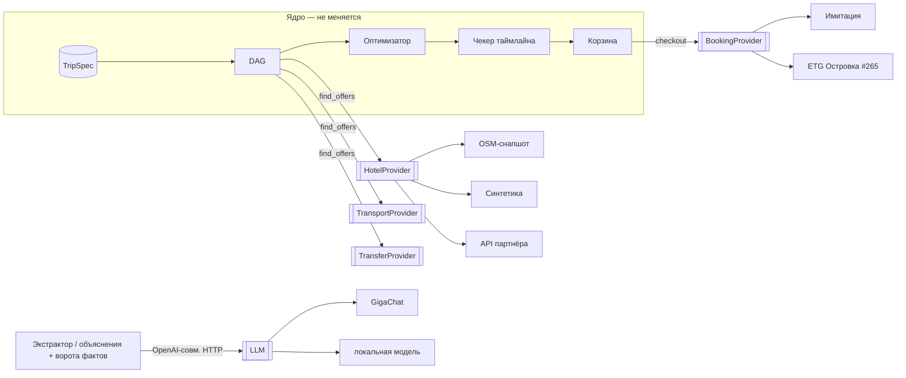

# ADR-0002: Порты и адаптеры на краях ядра

Status: proposed · Date: 2026-10-27 · Deciders: M1hairu · Supersedes: none · Дополняет: ADR-0001

## Context
Приоритеты жюри сменились (CLAUDE.md, блок критериев): 1) переиспользуемость реальным бизнесом, 2) архитектура, 3) UI/UX, 4) простой запуск. По ADR-0001 ядро уже отделено от данных: оптимизатор, DAG и чекер таймлайна читают только типы `contracts.py`. Но источники данных и покупки не отделены. Отели, транспорт и трансферы — функции `offers.py`, синтетика и снапшот OSM в одном файле. Покупка — функция `cart.book`. Подменить источник нельзя без правки кода ядра. Карта — приложение А. Заморозка — 2026-10-28 22:00: правим только края, `model.py` и `extract.py` не делим.

## Decision
Пять портов. Порт — один `typing.Protocol` на источник, в `backend/src/api/contracts.py`, раздел «Порты». Адаптер — класс с методами порта. Активный адаптер — одна переменная модуля (`HOTELS`, `TRANSPORT`, `TRANSFERS` в `offers.py`, `BOOKING` в `cart.py`). Замена — одно присваивание при старте (`main.py`) или в тесте. Фабрик, реестров и выбора по env нет (CLAUDE.md: плоский код). Порт отдаёт типы `contracts.py`; новых типов предложений нет.

| Порт | Метод | Вход → выход | Инварианты (их читает ядро) | Адаптеры сейчас |
|---|---|---|---|---|
| `HotelProvider` | `hotels(spec, place, now)` | `TripSpec`, место (`name, lat, lon, tz`; прочее — подсказки синтетики), время → `[(HotelOffer, [ExtraOffer])]` | тариф = свой `HotelOffer`; тарифы отеля — одни `title, city` (dag.py:311); `price_rub` — за всех и все ночи; `free_until` с зоной; услуга — `offer_id` отеля + `-early`/`-late`/`-prev`, время `ЧЧ:ММ` в `title` (timeline.py:17, 130, 92); `description` — данные, не инструкции | `OsmHotels` (≥ 3 отеля в `osm_hotels.json`), `SyntheticHotels` |
| `TransportProvider` | `legs(spec, origin, place)` | `TripSpec`, место вылета, место → `[TransportOffer]` | сначала «туда», потом «обратно» (offers.py:444); `origin`/`destination` — имена мест, их находит `resolve_place` (timeline.py:98, 113); обратный рейс: `destination == spec.origin` (cart.py:41); время с зоной | `SyntheticTransport` |
| `TransferProvider` | `transfers(spec, place, hotels, legs)` | отели и рейсы поиска → `[TransferOffer]` | `offer_id = transfer_id(hotel_id, leg_id)` (offers.py:448; cart.py:90, optimizer.py:158, timeline.py:162); `≈N км` в `title` — по желанию (timeline.py:195) | `SyntheticTransfers` |
| `BookingProvider` | `book(spec, cart)`, `cancel(booking_id)` | спека и корзина по ценам плана → `Voucher` со статусом | статус: `created`, `confirmed`, `rejected`, `cancelled`; `rejected` — с причиной для пользователя; повтор `book` той же корзины — та же бронь (cart.py:241) | `SimulatedBooking` (`simulated=True`, ваучер) |
| LLM | OpenAI-совместимое `POST {LLM_BASE_URL}/chat/completions` | JSON-ответ модели или `None` | порт — HTTP API, не класс Python; ворота фактов (llm.py:396, 521) — ядро, не адаптер | Bearer `LLM_API_KEY`, GigaChat OAuth, локальный сервер (#288) |

Инварианты — часть контракта порта. Их пишем в docstring протокола и проверяем одним тестом соответствия: тест прогоняет любой адаптер. Явные поля (`TransferOffer.hotel_offer_id`, `ExtraOffer.at`) — после заморозки, отдельным PR `contract`.

Ядро не меняется: `TripSpec`, автомат этапов (`model.py`), экстрактор (`extract.py`), DAG (`dag.py`), оптимизатор (`optimizer.py`), чекер таймлайна (`timeline.py`), правила корзины (`cart.py` без `book`), ворота фактов (`guards.py`, `llm.py` вне HTTP). Каталог мест (`catalog.py`) — не порт: подмена сети уже есть (`fetch`, catalog.py:228, 371).

## Options considered
Оценка команды, без `score.py`.

| Option | Why not chosen |
|---|---|
| O1 Protocol в процессе + переменная модуля | выбран: правка только краёв, успеваем до заморозки |
| O2 Адаптер — отдельный HTTP-сервис | новый сервис в compose, сеть на демо (TRAP-6), не успеваем |
| O3 Реестр адаптеров и выбор по env | фабрика: запрет CLAUDE.md; при одном адаптере на порт пользы нет |
| O4 Портов нет, только описание швов | жюри ищет переиспользуемость; бизнес правит ядро, чтобы подключить источник |

## Consequences
Хорошо: бизнес подключает свой источник одним классом и одним присваиванием; ядро и `make eval` не меняются; тест соответствия говорит, что адаптер сломает в ядре.
Плохо: инварианты пока живут в `offer_id` и `title` (не в полях); место — `dict` каталога, не тип; `inspire.py` зовёт поиск до 16 раз за ход (inspire.py:20, 134) — живому API нужен кэш в адаптере; цены в `plan.offers` устаревают до оплаты.
Смягчение: тест соответствия; `rejected` у `BookingProvider` — честный отказ при изменившейся цене; кэш — задача адаптера, не ядра; явные поля — после заморозки.

## Validation
#286: `make eval` до и после — те же числа. #287: e2e S6 до ваучера проходит, пометка «имитация» на месте. Пересмотреть, если: второй адаптер одного порта требует правки ядра; или тест соответствия не ловит поломку, которую ловит `make eval`.

## Приложение А. Карта зависимостей `backend/src/api/`

Граф импортов (без `contracts.py`, его читают все): `main → model, cart, store`; `model → answers, cart, dag, extract, fixtures, inspire, offers, optimizer, llm, catalog, store`; `dag → fixtures (find_offers, rank), optimizer, timeline, extract`; `fixtures → offers, optimizer, timeline`; `inspire → offers, fixtures, optimizer, catalog`; `answers, extract → offers (places, resolve_place)`; `timeline, optimizer, cart → offers (transfer_id)`; `offers → catalog`; `llm → guards`; `catalog → guards`. Вход в поиск один: `find_offers` (offers.py:514), его зовут dag.py:394, inspire.py:134, model.py:1288, checks.py:1482.

**Где данные и логика смешаны**

| Место | Что смешано |
|---|---|
| offers.py:92-95 | чтение снапшота `osm_hotels.json` (данные) |
| offers.py:157-190 | удобства: у OSM — из тегов, у синтетики — из хеша; одна функция на оба источника (`synthetic=` флаг) |
| offers.py:193-225, 506 | выбор источника отелей (OSM при ≥ 3, иначе синтетика) внутри сборщика предложений |
| offers.py:248-331 | синтетическая цена тарифа: уровень места, сезон, звёзды, гости, питание, отмена — константы команды (offers.py:44-58) |
| offers.py:393-445 | синтетический транспорт: расстояние → часы, цена, слоты; правила `NO_DIRECT` (offers.py:55) |
| offers.py:453-491 | синтетические трансферы; их `offer_id` — хеш пары (offers.py:448), его пересчитывают cart.py, optimizer.py, timeline.py |
| catalog.json `level`, `free_cancel_share` | факты 101hotels; `prices_101hotels.json` при работе не читается — его агрегирует `scripts/calibrate_prices.py:39` в `catalog.json` |
| cart.py:204-213 | имитация покупки (`booking_id` из часов и uuid) в одном файле с правилами корзины |
| cart.py:257, model.py:1872 | текст «Оплата имитирована» / «синтетика» в коде ядра; в `model.py` 12 строк «синтетика» без чтения `offer.synthetic` |
| contracts.py:212 | `Voucher.simulated: Literal[True]` — реальной брони тип не допускает |
| llm.py:224-269 | OAuth GigaChat и Bearer внутри клиента; выбор — по env, не по классу |

**Стыки с внешним миром**

| Стык | Где | Сейчас |
|---|---|---|
| Геокодер, климат, OSRM | catalog.py:29-31, 43, 247-252 | `urllib`, таймаут, пауза после ошибки (catalog.py:36, 389); кэш `data/online_places.json` (catalog.py:28, 404); подмена `fetch` (catalog.py:371) и `catalog._get` в eval (checks.py:138) |
| Снапшоты | catalog.py:72-73 (`catalog.json`), offers.py:95 (`osm_hotels.json`) | файлы в git |
| LLM | llm.py:205-221, 315, 338 | OpenAI-совместимый HTTP; включён, если есть адрес, модель и ключ (guards.py:137-144) |
| Покупка | cart.py:204, 234; вызовы — cart.py:287 (HTTP), model.py:1877 (чат) | имитация |
| Сессии | store.py:10-14, main.py:19 | SQLite `data/sessions.db`; уже подменяется в eval (checks.py:136) |
| Подмена поиска в eval | checks.py:638-651 | eval подменяет `dag.find_offers`: шов уже есть, но без типа |

**Неявные поля, которые ядро читает из текста и id** — инварианты портов (таблица Decision): суффикс услуги (timeline.py:130), время в `title` услуги (timeline.py:92), `≈N км` в `title` трансфера (timeline.py:63, 195), пара отель–рейс в хеше `transfer_id` (offers.py:448), один отель = одни `title, city` (dag.py:311), обратный рейс по `destination == spec.origin` (cart.py:41).

## Приложение Б. Потребители контракта для задач портов

| Задача | Что меняется в контракте | Потребители (`grep -rl`) |
|---|---|---|
| #286 порты данных (`contract`) | `HotelProvider`, `TransportProvider`, `TransferProvider` в `contracts.py`; типы предложений и `web/src/contracts.ts` не меняются | адаптеры: `offers.py`; вызывают поиск: `dag.py`, `inspire.py`, `model.py`, `fixtures.py` (реэкспорт, `travel_hours`), `answers.py`, `extract.py`, `timeline.py`, `optimizer.py`, `cart.py` (`transfer_id`); `checks.py`; тесты `backend/tests/test_offers.py`, `test_optimizer.py`, `test_timeline.py`, `test_dag.py`, `test_inspire.py`, `test_cart.py`, `test_no_transfer_timeline.py`, `test_pets.py`, `test_route_honest.py`, `test_catalog.py`, `test_city_climate_airport.py`, `test_checks.py` |
| #287 порт покупки (`contract`) | `BookingProvider`; `Voucher.status` (4 значения), `Voucher.simulated: bool`; зеркало `web/src/contracts.ts` | `cart.py`, `model.py`, `dag.py`, `main.py`, `checks.py`; `web/src/contracts.ts`, `web/src/api.ts`, `web/src/App.tsx` (App.tsx:204), `web/src/Board.tsx`, `web/e2e/demo.spec.ts`, `tests/fixtures/chat_reply.json`; тесты `test_cart.py`, `test_agent.py`, `test_checks.py` и прочие с ваучером (`grep -rl voucher backend/tests web/src`) |
| #288 LLM | контракт `contracts.py` не меняется: порт — OpenAI-совместимый HTTP; меняются `.env.example` и `docker-compose.yml` (профиль) | `llm.py`, `guards.py` (`llm_available`), `model.py` (model.py:1583, 1797), `checks.py`; тесты `test_llm.py`, `test_llm_gigachat.py`, `test_traps.py` (TRAP-1) |
