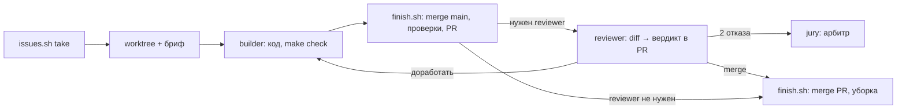

# Агенты

Определения — `.claude/agents/*.md`, модель — поле `model:` (haiku не используем).
В промпте роли — только отличие: что видит, что может, что возвращает. Правила
проекта агенты берут из `CLAUDE.md`. Общего оркестратора нет: каждый участник ведёт
свои задачи скиллом `/orchestrate`.

Язык: определения ролей, промпты субагентам и работа субагента — на английском. Отчёт
человеку, вердикт в PR, коммиты, тексты интерфейса и документы — на русском.

Codex: те же роли в `.codex/agents/<роль>.toml` (их генерирует `scripts/codex-sync.py`),
запуск — `spawn_agent` с `agent_type: "<роль>"`, скилл — `$orchestrate` (`AGENTS.md`).
Модель для Codex в роли не задана: её задаёт сессия участника.

| Роль | Модель | Когда | Видит и может | Возвращает |
|---|---|---|---|---|
| `builder` | sonnet; opus при сложности «высокая» | одна задача | свой worktree; `make`; коммит и `finish.sh`; контракт и зависимости не меняет | строка «что изменилось», проверки, eval было → стало |
| `reviewer` | opus | «сборка» — каждый PR; «финал» — contract, формат, diff > 300 | только diff и задача; ищет утечку test/holdout, факт без источника, заглушку в демо-пути, контракт без потребителей; скептик для решений | вердикт merge / доработать / человеку; merge — комментарием в PR |
| `evaluator` | sonnet | изменение метода, веха, заморозка | `make eval`; `make eval-final` только по заморозке | таблица baseline / было / стало, сценарии |
| `operator` | sonnet | веха, после UI | интерфейс в роли пользователя из брифа | где роль спотыкается, топ-5 |
| `jury` | opus | веха, заморозка, сдача; арбитр после двух отказов | только артефакты; критерии из брифа | баллы 0–3, топ-5 действий; вопросы жюри |
| `critic` | opus | перед вехой; после крупной правки ядра, контракта, канала ввода; новый вопрос жюри | бриф, условия, код демо-пути, `eval/cases*.json`; код не правит | новые неочевидные сценарии с механизмом поломки и проверкой |
| `silent-failure-hunter` | sonnet | перед демо и сдачей; результат правдоподобен, но неверен | код; ничего не правит | тихие ошибки: пустой catch, подмена ошибки значением, fallback, вызов без таймаута |
| `scribe` | sonnet | README, факты для питча | worktree; выполняет то, что описывает | документы, факты «утверждение → цифра → команда» |
| `pitch` | sonnet | после заморозки | бриф, факты scribe, `pitch/QA.md` | структура слайдов, текст по регламенту, ответы |

## Конвейер задачи

Веха: `critic` → `evaluator` → `operator` → `silent-failure-hunter` → `jury` →
`submission-checklist`. Заморозка: человек
переключает режим → `evaluator` (`make eval-final`) → `scribe` → `pitch`.
